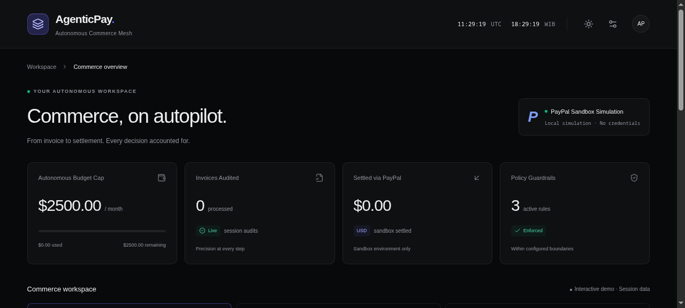
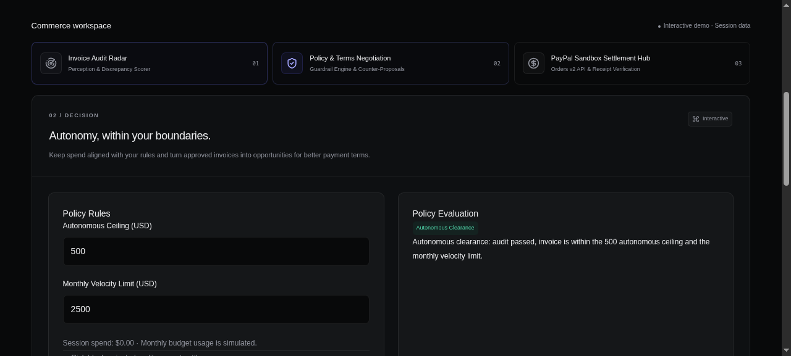
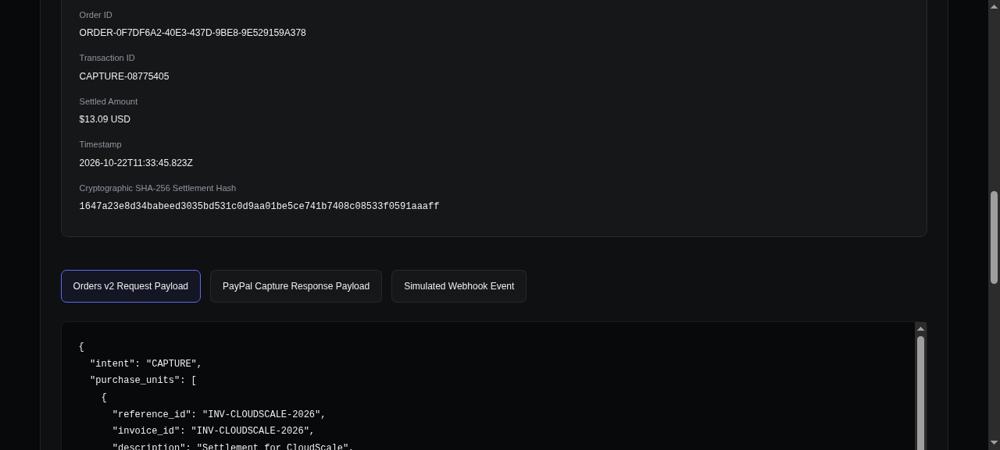
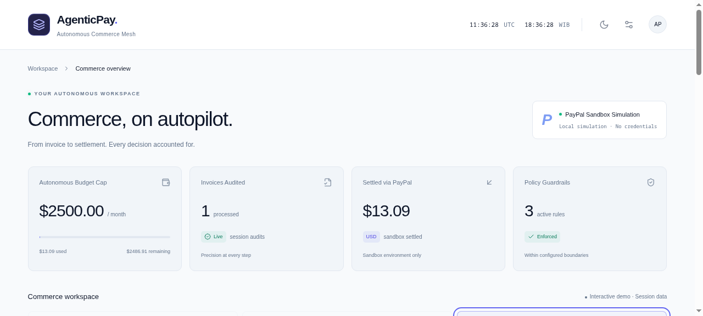

# AgenticPay (PayMesh)
> **Autonomous Agentic B2B Commerce Protocol — Auditing Invoices, Enforcing Guardrails, Negotiating Terms, and Settling via PayPal Orders v2.**  
> Built for the **PayPal AI Hackathon 2026** on Devpost by **Catur Setyono**.

[](https://github.com/CaturSetyono/agentic-pay)
[](https://github.com/CaturSetyono/agentic-pay)
[](https://developer.paypal.com/)
[](LICENSE)

---

## ⚡ Overview
In traditional enterprises, accounts payable (AP) is manual, slow, and prone to leakage: rogue SaaS subscriptions, contractor rate drifts, and unauthorized surcharges slip through, while cash discounts for early settlement are left on the table.

**AgenticPay** reimagines corporate payments as an intelligent, autonomous pipeline. It acts as an autonomous treasury agent that:
1. **Perceives & Audits:** Ingests vendor invoices, verifies arithmetic, checks contracted rate cards, and scores discrepancy risks (0–100).
2. **Enforces Guardrails:** Applies dynamic corporate spending ceilings ($500 default) and department monthly velocity limits ($2,500). Clean invoices clear autonomously; rate deviations and high amounts escalate to human controllers.
3. **Autonomously Negotiates:** Proposes 2–5% Net-10 early settlement discounts (saving real treasury dollars) and multi-tranche milestone schedules.
4. **Settles via PayPal Orders v2:** Constructs compliant PayPal Orders v2 payloads, executes simulated sandbox captures, and generates verifiable **SHA-256 cryptographic settlement receipts**.

---

## 📸 Screenshots

| 01. Invoice Audit Radar (Dark Mode) | 02. Policy & Negotiation Engine |
| :---: | :---: |
|  |  |

| 03. PayPal Sandbox Settlement Hub | 04. Modern Clean Light Mode |
| :---: | :---: |
|  |  |

---

## 🏗 Architecture & Modules

```
┌────────────────────────────────────────────────────────┐
│                   AgenticPay Mesh                      │
└────────────────────────────────────────────────────────┘
                           │
       ┌───────────────────┼───────────────────┐
       ▼                   ▼                   ▼
┌──────────────┐   ┌──────────────┐   ┌────────────────┐
│  01 / RADAR  │   │ 02 / POLICY  │   │  03 / PAYPAL   │
│  Perception  │──▶│  Guardrail   │──▶│ Orders v2 API  │
│  & Audit     │   │  Engine &    │   │ & SHA-256 Hash │
│  (0-100 Risk)│   │  Negotiation │   │ Verification   │
└──────────────┘   └──────────────┘   └────────────────┘
                           │
                           ▼
              ┌─────────────────────────┐
              │ Live Agent Thought Log  │
              │   & Settlement Ledger   │
              └─────────────────────────┘
```

- **`src/lib/agent/audit.ts`**: Text invoice ingestion, math verifier, vendor rate card validator, risk scorer.
- **`src/lib/agent/policy.ts`**: Corporate spending guardrails, autonomous clearance thresholds, approval escalations.
- **`src/lib/agent/negotiate.ts`**: Autonomous cash discount calculation, counter-offer generator, milestone scheduler.
- **`src/lib/paypal/client.ts` & `src/lib/paypal/payload.ts`**: PayPal Orders v2 schema, capture simulation, webhook verification.
- **`src/lib/paypal/sandbox.ts`**: Deterministic SHA-256 settlement hash digest, mock sandbox transaction runner.
- **`src/components/`**: Modular Mercury/Linear UI shell, reactive tabs, dual UTC/WIB clocks, live agent thought stream.

---

## 🧪 Rigorous Test-Driven Development (TDD)
AgenticPay is built following strict TDD standards (RED -> GREEN -> REFACTOR) using the native Node.js 22 test runner:

```bash
# Run the 27-suite test matrix
npm test

# Typecheck with TypeScript compiler
npm run typecheck

# Build production bundle
npm run build
```

### Test Coverage Highlights:
- **`tests/audit.test.mjs`**: Ingestion, arithmetic checks, rate drift detection, phantom fee detection.
- **`tests/policy.test.mjs`**: Autonomous clearance under $500, human escalation above $500, risk gates, velocity caps.
- **`tests/negotiate.test.mjs`**: Net-10 3% discount rounding, multi-tranche milestone balance reconciliation.
- **`tests/paypal.test.mjs`**: Orders v2 schema compliance, idempotency keys, capture simulation, webhook verification.
- **`tests/agent-flow.test.mjs`**: Full end-to-end integration flow from raw text to settled SHA-256 receipt.
- **`tests/workspace.test.mjs`**: Preset data integrity, pre-paint theme switching, reactive policy controls.

---

## 💻 Tech Stack
- **Framework:** Next.js 16 (Turbopack, App Router), React 19
- **Languages:** TypeScript, Modern Node.js
- **Styling:** Tailwind CSS (Custom Dark `#08090a` & Clean Light design tokens)
- **Icons:** Lucide React
- **Payments:** PayPal Orders v2 API Schema (`POST /v2/checkout/orders`)
- **Remote Sandbox:** Cloudflare Tunnel (`https://object-livecam-division-deny.trycloudflare.com`)

---

## 🏆 Hackathon Submission Materials
- **Devpost Submission Copy:** [`docs/DEVPOST_SUBMISSION.md`](docs/DEVPOST_SUBMISSION.md)
- **3-Minute Demo Video Script:** [`docs/DEMO_WALKTHROUGH.md`](docs/DEMO_WALKTHROUGH.md)
- **Project Blueprint:** [`PROJECT_PLAN.md`](PROJECT_PLAN.md)

---

## 👤 Author
Developed autonomously with precision by **Catur Setyono** (tyodev).  
GitHub: [@CaturSetyono](https://github.com/CaturSetyono)
